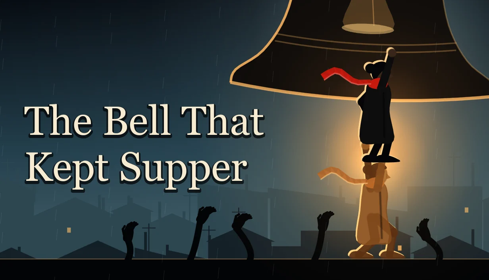
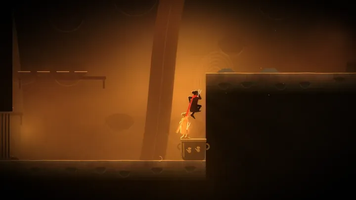
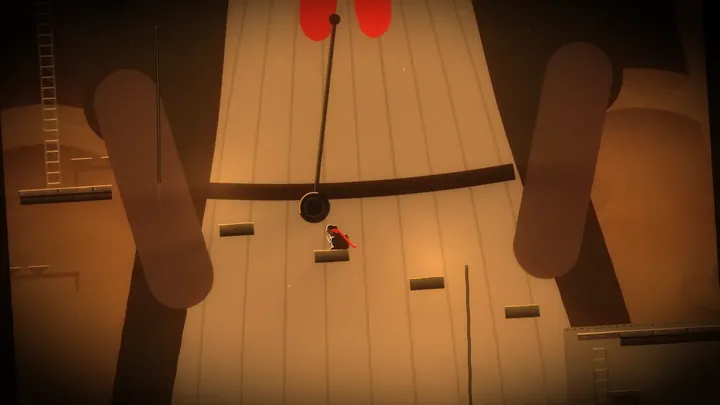
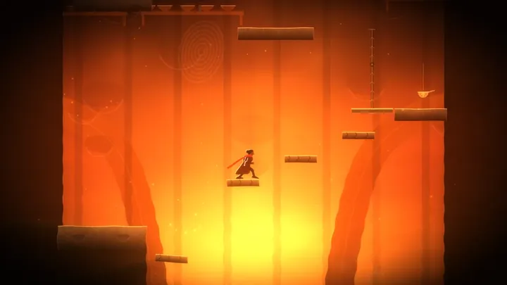
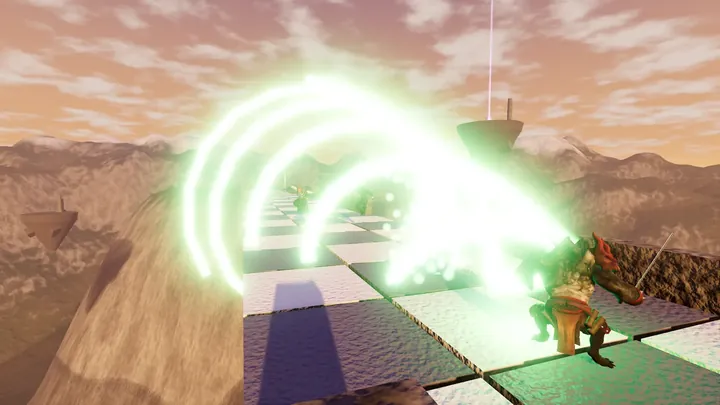
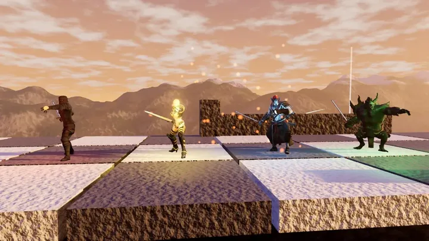
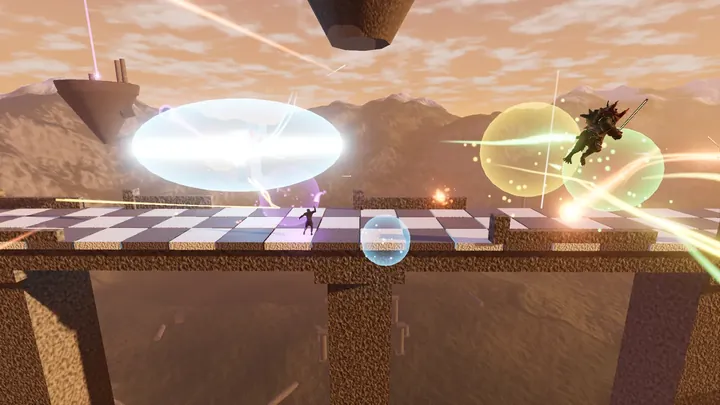

<div align="center">



<br />

<a href="https://tanvir0x1-github-io.vercel.app"></a>
<a href="https://www.linkedin.com/in/md-obaidul-amin-1329772b7/"></a>
<a href="mailto:tanvir.hossain7492@gmail.com"></a>


</div>

### What I'm working on

```text
building     →  The Bell That Kept Supper and Aether Clash, two games in Godot 4
shipping     →  four Android apps, on their way to Google Play
researching  →  retrieval-augmented generation + LLM re-ranking for rare disease diagnosis
ask me about →  Python + ML, full-stack web, three.js, Godot, Flutter
```


### Latest builds

<a href="https://tanvir0x1-github-io.vercel.app/project.html?p=the-bell-that-kept-supper"></a>

**[The Bell That Kept Supper](https://tanvir0x1-github-io.vercel.app/project.html?p=the-bell-that-kept-supper)**, a co-op game for one. Ring a bell, live ten seconds, ring again: now there are two of you. [Watch the trailer](https://tanvir0x1-github-io.vercel.app/project.html?p=the-bell-that-kept-supper). Source: [TheBellThatKeptSupper](https://github.com/tanvir0x1/TheBellThatKeptSupper) (private for now).

- **Puzzles:** 39 rooms in seven chapters, built on cooperating with a bronze echo of your own last ten seconds
- **Made in code:** every picture is drawn by the game and every sound is synthesised, with shaders for fog, water, terrain and light
- **Tested by bots:** a bot plays all 39 rooms, and a random player tries to break them
- **Delivery:** Windows builds of the game and a nine-room demo, with keyboard and controller support

<a href="https://tanvir0x1-github-io.vercel.app/project.html?p=the-bell-that-kept-supper">

</a>

<br />



**[Aether Clash](https://tanvir0x1-github-io.vercel.app/project.html?p=aether-clash)**, an online battle arena where everyone picks an element, takes flight over a sunset mountain arena and fights. [Watch the video](https://tanvir0x1-github-io.vercel.app/project.html?p=aether-clash).

- **Multiplayer:** up to 8 players over ENet, with player-hosted matches and a dedicated server
- **Combat:** five elements, each with a basic attack and a special, plus power orbs, dashes, sword strikes and free flight
- **Look:** custom sky, terrain and effect shaders, power trails, four animated Mixamo characters
- **Delivery:** exported to a single Windows `.exe`

<a href="https://tanvir0x1-github-io.vercel.app/project.html?p=aether-clash">

</a>


### Experience

<table>
<tr>
<td width="50%" valign="top">

**🎮 Game development**<br />
<sub>Godot 4, GDScript, C#, three.js, WebGL2</sub>

- [The Bell That Kept Supper](https://tanvir0x1-github-io.vercel.app/project.html?p=the-bell-that-kept-supper), a 39-room puzzle platformer in **Godot 4.7**, with code-drawn art and synthesised sound
- [Aether Clash](https://tanvir0x1-github-io.vercel.app/project.html?p=aether-clash), an online 3D arena in **Godot 4.7** with ENet networking, shaders and Mixamo animation
- [Nitro Vendetta](https://road-rash-seven.vercel.app/), a 3D bike combat racer with 4-player online races
- [Emberwing](https://emberwing-ruddy.vercel.app/), a voxel dragon adventure with ten guardian bosses
- [Salvo](https://salvo-silk.vercel.app/), a 5 vs 5 arena shooter in WebGL2
- [Shadow Path](https://shadow-path-ninja.vercel.app/), [Cube IQ](https://mindmaze-tau.vercel.app/) and [Pip's Quest](https://pip-quest-web.vercel.app/) ([C# source](https://github.com/tanvir0x1/pip-quest))

</td>
<td width="50%" valign="top">

**📱 Android apps**<br />
<sub>Flutter, Dart, Kotlin, Capacitor, Gradle</sub>

- **Neon Puzzle Box:** 15 offline puzzle games with a boss every 50 levels
- **Pandaberry:** triple tile-matching with 2,000 levels
- **WiFi FTP Transfer:** phone to PC file copying, native Kotlin
- **Cosmos for Android:** an offline 3D universe explorer
- Release work too: signing, store listings, privacy policies

</td>
</tr>
<tr>
<td width="50%" valign="top">

**🌐 Full-stack and 3D web**<br />
<sub>Next.js, React, TypeScript, Node, Express, Prisma</sub>

- [Cosmos](https://cosmos-silk-one.vercel.app/), the universe at true scale with 9,110 real stars
- [Caseform](https://caseform-preview.vercel.app/), a 3D storefront lit by a hand-written shader
- [Rostrum](https://rostrum-pearl.vercel.app/), a photo motion studio with 48 effects, sign-in and Stripe integration
- **Wajood** and **Aloka**, complete shops with cash on delivery, order tracking and admin panels
- [Flipspin](https://flipspin.vercel.app/), an illusion maker that exports video, and portfolio sites for clients

</td>
<td width="50%" valign="top">

**🧠 AI and ML research**<br />
<sub>PyTorch, Transformers, LangChain, LangGraph, ChromaDB</sub>

- [Rare disease diagnosis with RAG](https://github.com/tanvir0x1/rare-disease-eval): MedGemma 27B re-ranking raised Recall@5 from 0.480 to 0.811 on 513 external cases where retrieval had found the disease
- **Federated self-supervised learning** for chest X-rays, across five simulated hospitals
- **Continual learning** for brain tumour MRI with a Swin Transformer
- **Hybrid quantum-classical** tumour classification
- A multi-LLM medical chatbot built with LangGraph

</td>
</tr>
</table>


### Toolkit

<table>
<tr>
<td><b>Games and 3D</b></td>
<td>
<br />
<sub>Godot 4 · GDScript · GLSL and Godot shaders · ENet · WebGL2 · React Three Fiber · Raylib · Mixamo</sub>
</td>
</tr>
<tr>
<td><b>Mobile</b></td>
<td>
<br />
<sub>Capacitor · Android SDK · Google Play release prep</sub>
</td>
</tr>
<tr>
<td><b>Web</b></td>
<td>
<br />
<sub>Framer Motion · Zod · NextAuth · Stripe</sub>
</td>
</tr>
<tr>
<td><b>AI and ML</b></td>
<td>
<br />
<sub>Hugging Face Transformers · LangChain · LangGraph · ChromaDB · BM25 · Gradio</sub>
</td>
</tr>
<tr>
<td><b>Data</b></td>
<td>
<br />
<sub>Power BI</sub>
</td>
</tr>
<tr>
<td><b>Languages and tools</b></td>
<td>

</td>
</tr>
</table>


### Contributions

<!-- Rebuilt every 6 hours by .github/workflows/profile.yml -->


<br /><br />

<div align="center">
  <picture>
    <source media="(prefers-color-scheme: dark)" srcset="https://raw.githubusercontent.com/tanvir0x1/tanvir0x1/output/github-snake-dark.svg" />
    <source media="(prefers-color-scheme: light)" srcset="https://raw.githubusercontent.com/tanvir0x1/tanvir0x1/output/github-snake.svg" />
    
  </picture>

<br />

### Let's make something interesting

I'm open to full-stack, Android and game projects, research collaborations and graduate study.<br />
[Send me an email](mailto:tanvir.hossain7492@gmail.com)

</div>


